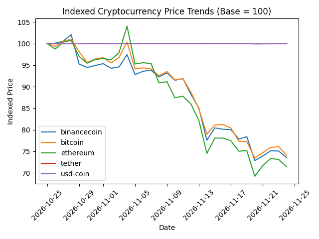

# Cryptocurrency Market Data Pipeline

An educational Python and SQLite pipeline originally developed for the Programming for Data Analysis module at Dublin Business School. The portfolio version was refactored with AI assistance from the original Colab notebook.

## Architecture

CoinGecko REST API → pandas transformations → SQLite → Matplotlib

- Fetch the top five cryptocurrencies by market capitalisation and request 30 days of historical data.
- Align prices, market capitalisation and volume by timestamp.
- Select the last available observation per UTC calendar day.
- Calculate indexed prices (base 100), daily returns, 7- and 30-day moving averages and 7-day rolling return volatility.
- Store historical observations and the latest record per coin in SQLite.
- Generate a comparative indexed-price chart.

## Setup

```bash
git clone https://github.com/Poongundrane/Crypto-data-Pipeline.git
cd Crypto-data-Pipeline
python -m pip install -r requirements.txt
python pipeline.py
```

Internet access is required. CoinGecko access policies and rate limits may affect execution. The script uses bounded retries and does not require a hardcoded credential.

## Repository structure

- `pipeline.py`: acquisition, transformation, storage and visualisation.
- `requirements.txt`: Python dependencies.
- `tests/test_pipeline.py`: offline feature and database checks.
- `.gitignore`: excludes generated databases, charts and local environment files.

## Outputs

- `crypto_data.db`: tables `crypto_prices` and `crypto_summary`.
- `indexed_prices.png`: comparative price chart.

Example SQL query:

```sql
SELECT coin, timestamp, price, ma7, ma30
FROM crypto_summary
ORDER BY coin;
```

## Testing

```bash
python -m unittest discover -s tests -v
```

Tests use synthetic observations rather than live market data. All three offline tests passed in Google Colab (0.095 seconds) before the API retry update.

## Verified execution

On 24 November 2026, the updated pipeline successfully retrieved Bitcoin, Ethereum, Tether, BNB and USD Coin and reported 155 daily records across five coins in Google Colab. The coin selection and record count may vary on subsequent runs.

The pipeline spaces coin requests by 25 seconds and uses up to five attempts for HTTP 429 responses, with exponential waiting and support for numeric Retry-After headers. An optional CoinGecko Demo API key can be supplied through the `COINGECKO_DEMO_API_KEY` environment variable. Never commit API keys. Network availability and rate limits can still affect execution. The sample chart below was visually reviewed; database contents have not been independently inspected.

### Sample output



All five series start at 100. In this sample run, Ethereum, Bitcoin and BNB declined, while Tether and USD Coin remained close to their initial indexed values. This is a historical sample, not a forecast.

## Limitations

Daily values represent the last available observation, not an official exchange closing price. The latest day may be incomplete. Moving averages use available observations within their windows; missing days are not forward-filled. API availability and coin selection can change. This is an educational project, not a trading system.

## Attribution

Market data: [CoinGecko API](https://www.coingecko.com/en/api). Original academic project by Poongundran Elanthiraiyan. ChatGPT was used as a learning co-pilot in the original coursework and to assist with the portfolio refactor and documentation.

See LICENSE for code licensing. Data remains subject to the provider's terms.
